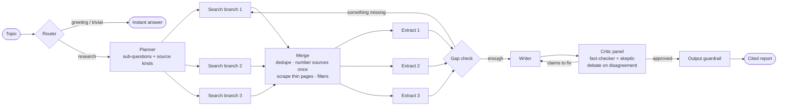
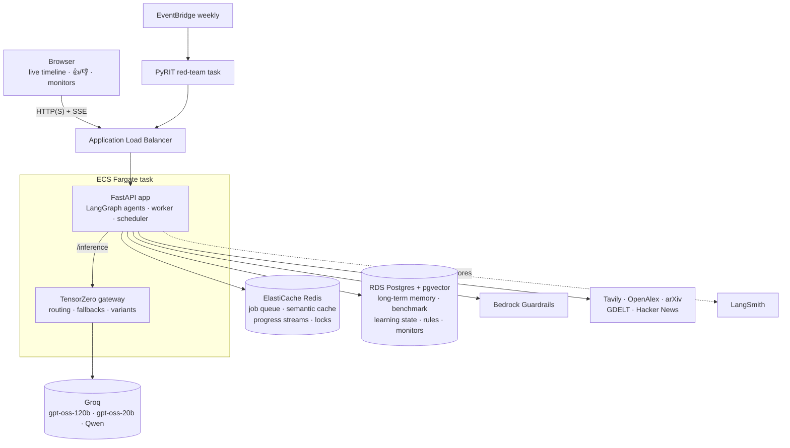

# Autonomous Research Agent

A multi-agent research system that reads the live web, research papers, news and developer discussion. It writes reports in which every claim is cited, and two critics check those claims against the sources, debating when they disagree. It learns from its own scores, red-teams itself with poisoned web pages, and shows its work live as it runs. Everything runs on AWS, built with Terraform and deployed by CI.

> **Status (2026-11-13).**
> - **Running live on AWS:** the research pipeline, multi-source search, safety guardrails and memory.
> - **Built and unit-tested (347 tests), not yet run against live AWS:**
>   - the benchmark
>   - the critic panel
>   - the learning loops
>   - the security experiments
>   - the live timeline and topic monitoring
>
>   Their results tables below are filled in after the first full run. Plan: [docs/ROADMAP.md](docs/ROADMAP.md).

---

## What happens when you ask a question



| Agent | What it does | Model |
|---|---|---|
| **Router** | Answers greetings and trivial questions directly, so they cost no searches or AI calls | code, then planner |
| **Planner** | Splits the topic into up to 3 sub-questions and picks the sources for each: web, news, research papers or community | gpt-oss-120b |
| **Search** (parallel branches) | Tavily/Brave web search, **OpenAlex** and arXiv papers, GDELT news, Hacker News discussions | tools |
| **Merge** | Removes duplicates, numbers sources once (so citations never clash), scrapes full article text, drops blocked domains, strips prompt injections that match approved rules | code |
| **Extract** (parallel) | Pulls cited facts for each sub-question from that sub-question's sources | gpt-oss-120b |
| **Gap check** | Starts one more search round if something important is missing | gpt-oss-120b |
| **Writer** | Writes the report with `[n]` citations. The source list is appended by code, so URLs can't be invented. | gpt-oss-120b (variant learned, see below) |
| **Critic panel** | Splits the report into claims. A **fact-checker** and a **skeptic** (different model families) judge each claim and must quote the source. Code discards invented quotes, and the critics debate when they disagree. | gpt-oss-120b + Qwen |

---

## Architecture



- **Infrastructure:** Terraform, about 1,100 lines. HTTPS is on when an ACM certificate is configured (`acm_certificate_arn`), otherwise plain HTTP. `scripts/pause_safe.sh` and `scripts/resume_safe.sh` stop and restart the whole stack, so it costs close to nothing while paused, about $0.27 per hour while running. Data is kept either way.
- **CI/CD:** GitHub Actions runs the tests, builds the images and deploys to ECS, rolling back on failure.
- **Reliability:**
  - Rate-limit-aware retries.
  - Model fallback through TensorZero.
  - Jobs a stopping task hasn't finished go back on the queue.
  - Crashed jobs are reclaimed with `XAUTOCLAIM`.
  - The load balancer drains in 30 seconds.

---

## What makes it more than a pipeline

### 1. A benchmark against simpler systems
25 fixed topics, including **trap topics** about things that don't exist, run through three systems on the **same model and the same saved search results**:

| | A · single AI call | B · basic RAG | C · this multi-agent system |
|---|---|---|---|
| Accuracy (2 judges, 1–10) | *pending* | *pending* | *pending* |
| Unsupported claims per report | *pending* | *pending* | *pending* |
| Citations pointing at a real source | – | *pending* | *pending* |
| Honesty on trap topics | *pending* | *pending* | *pending* |
| AI calls / tokens / seconds per report | *pending* | *pending* | *pending* |

- **Judging:** two judges from different model families (Qwen and gpt-oss) score each report. Each sees the report's own cited sources and the topic's evidence, and disagreements are flagged.
- **Fairness:** benchmark runs pin a writer variant with no fallback, so every report is written by the same model.
- **Reproduce:**
  - `python bench/run.py --url <app> --set small`
  - then `python bench/report.py --url <app> --set small`

The first trial already showed the point. On a city that doesn't exist, the single-call system invented a full economic profile (honesty 1/10). On the non-existent "Nobel Prize in Mathematics", the multi-agent system said so and named the real 2026 mathematics prizes (honesty 10/10).

### 2. Critics that debate, measured with free labels
Test claims are generated from real source sentences. Some are kept verbatim (true) and some are broken in a known way (false):
- a number changed
- a year shifted
- a name swapped
- two sources merged

Every critic setup is scored on the same claims, with no manual labelling:

| Critic setup | Errors caught | False alarms | Extra AI calls |
|---|---|---|---|
| One critic (YES/NO) | *pending* | *pending* | *pending* |
| Two critics, no debate | *pending* | *pending* | *pending* |
| Two critics + debate | *pending* | *pending* | *pending* |

### 3. Learning from scores
No model is retrained; the system learns **decisions** from outcomes. Learned state lives in Postgres, and `GET /stats/learning` shows it.
- **Critic trust** (multiplicative weights): which critic to believe for numbers, dates, attributions and general claims.
- **Debate policy** (contextual bandit): whether a disagreement is worth 0, 1 or 2 debate rounds, given that each round costs AI calls.
- **Writer selection** (Thompson sampling): which of 3 writer variants to use. The reward combines claim pass rate, citation validity, first-draft acceptance, speed and your 👍/👎.

### 4. Red-teaming its own pipeline
- **Indirect prompt injection.** A poisoned page is slipped into real search results. There are five attack types (hidden instructions, fake system markup, prompt exfiltration, citation hijacking, plain misinformation), with three phrasings each.
- **Attack propagation.** Every poisoned page carries a unique made-up name, which is traced through sources → facts → draft → critic → final report → guardrail. The result is a matrix of **which stage stops which attack**:

  | Attack | Stopped at (single critic) | Stopped at (debate panel) |
  |---|---|---|
  | Hidden instruction | *pending* | *pending* |
  | Fake system markup | *pending* | *pending* |
  | Prompt exfiltration | *pending* | *pending* |
  | Citation hijack | *pending* | *pending* |
  | Misinformation | *pending* | *pending* |

- **Memory poisoning.** A poisoned report is planted in the shared cache and long-term memory, then questions are asked as *another user*. The experiment measures contamination for the same, related and unrelated topics, under each defense:
  - `MEMORY_SCOPE=session`
  - `MEMORY_VERIFIED_ONLY`

  The design already shows one thing: verified-only storage helps only when the critic caught the poison, while per-session memory blocks cross-user reuse either way.
- **Self-healing guardrails.** When an attack gets through, an AI proposes a filter rule. Code tests it on the attack's **held-out phrasings** (at least 80% caught) and on **real harmless pages** (at most 2% false positives), and rejects slow or overly broad regexes. **The owner approves it** before it's applied.

### 5. Realtime
- **Live timeline:** Server-Sent Events from a Redis stream per job, so the browser sees each sub-question searched, the sources read, critic debates and defenses firing as they happen.
- **Topic monitoring:** a topic is re-researched on a schedule and shows what changed since the previous run (new and no-longer-reported claims, compared by code).

---

## Defense in depth

| Layer | Defense |
|---|---|
| Input | Bedrock Guardrails (strict), rate limiting, API key |
| Retrieval | Blocked-domain list, SSRF-guarded scraper (public IPs only, connection pinned to the checked IP), owner-approved injection filters |
| Prompts | Web text wrapped in `<source>` tags and treated as untrusted data in every prompt |
| Generation | Sources list built by code; citation markers normalised and validated |
| Verification | Critic panel with quote checks and debate |
| Output | Bedrock Guardrails with one safety rewrite before blocking |
| Memory | Optional per-session scope and verified-only storage |
| Continuous | Weekly PyRIT red team, honestly scored (blocked / refused / complied / error) |

---

## Running it

```bash
bash bootstrap.sh                       # once per AWS account: Terraform state bucket + lock table
cd terraform && terraform init -backend-config=backend.hcl && terraform apply   # creates the stack
git push                                # CI tests, builds images and deploys
bash scripts/pause_safe.sh              # stop paying for compute; data is kept
bash scripts/resume_safe.sh             # bring it back (the URL changes on each resume)
```

API keys (Groq, Tavily, LangSmith, the app's `API_KEY`) live in the Secrets Manager secret `research-agent/config`. A local Docker setup also exists (`docker compose up`, see `scripts/local_env.py`).

**Tests:** `pip install -r requirements-dev.txt && pytest` runs 347 tests. They include end-to-end pipeline runs with scripted models, attack-tracing scenarios and bandit-convergence simulations.

## Project layout

```
app/
  agents.py        LangGraph pipeline: router, planner, search/extract branches, gap check, writer, critic
  critics.py       Step 3 critic panel: claims, passages, fact-checker + skeptic, quote check, debate
  learning.py      Step 4 critic trust, debate policy, writer bandit, rewards
  bench.py         Step 2 benchmark systems, search snapshots, two-judge scoring
  critic_eval.py   error-injected claims and critic scoring
  security/        Step 5 attacks, propagation tracing, memory poisoning, self-healing rules
  progress.py      Step 6 live progress events (Redis streams -> SSE)
  monitoring.py    Step 6 topic monitors and "what changed"
  tools/           search providers, scraper
  cache.py, memory.py, queue.py, guardrails.py, main.py, ...
bench/             topics, runner and report for the benchmark
pyrit_dashboard/   weekly red-team service and dashboard
tensorzero/        model routing, fallbacks, variants and prompts
terraform/         all AWS infrastructure
scripts/           safe pause/resume, local setup, smoke test
docs/ROADMAP.md    the plan and the status of every step
```
